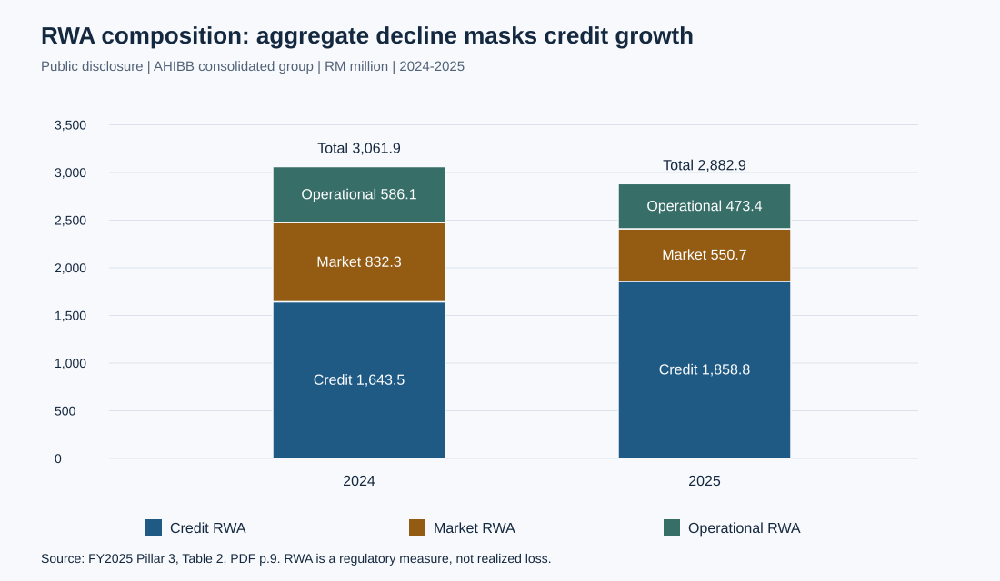

# Disclosure-Based Capital Adequacy Analysis

[中文](README.zh-CN.md)

Capital-ratio decomposition and reverse stress testing of Affin Hwang Investment Bank (2024–2025).

A research report on the relationship between regulatory capital strength, changes in risk composition, and the design of operational transformation. The study combines verified FY2024–FY2025 disclosures with a separately identified scenario framework for risk prioritization and credit sensitivity.

**Central finding:** the improvement in the consolidated CET1 ratio is predominantly associated with a smaller RWA denominator. Credit RWA increased even as total RWA declined. Capital adequacy therefore supports a narrower conclusion than a claim of comprehensive risk reduction.



## Research findings

| Analysis | Result | Evidence status |
|---|---|---|
| Consolidated CET1 ratio | 35.273% in 2024 to 37.573% in 2025 | Public disclosure |
| Symmetric ratio decomposition | +0.108 percentage points from capital and +2.193 from RWA | Computed from disclosed amounts |
| Consolidated risk composition | Total RWA −5.84%; credit RWA +13.10% | Computed from public disclosure |
| Standalone comparison | CET1 improvement +0.872 percentage points; total RWA −1.96% | Computed from disclosed amounts |
| Reverse stress at a 20% analytical reference | Consolidated loss capacity falls from RM506.6m to RM218.3m when RWA rises by 50% | Conditional scenario, not a forecast |
| Joint loss–RWA boundary at a 30% analytical reference | After an assumed RM100m loss, consolidated RWA expansion is limited to 13.68% at that reference | Conditional scenario, not a bank limit |
| Credit sensitivity | RM9.025m gross-basis expected loss; RM8.017m net-basis sensitivity | Illustrative source inputs, not a bank provision |

The analysis connects evidence scope, financial identities, sensitivity analysis, and decision design through reproducible calculations. It is a single-institution analytical study; it does not estimate causal effects or bank-specific event probabilities.

The denominator-led interpretation holds under both sequential attribution paths. The extended capital frontier shows how loss absorption and RWA expansion draw on the same capacity. See [the report](docs/en/report.md#41-the-joint-lossrwa-frontier) for the equation, signed shortfalls and assumptions.

## Read the study

- [Research report and methods](docs/en/report.md): business model, entity comparison, capital decomposition and path robustness, reverse stress and capital frontiers, ordinal risk sensitivity, and implementation design.
- [Evidence audit and material corrections](docs/en/evidence-audit.md): sources, rejected interpretations, and unresolved claims.
- [References and source provenance](docs/en/references.md): primary sources and traceable input records.
- [Data dictionary](data/README.md) and [machine-readable results](results/summary.json).

## Reproduce

Use Python 3.10 or later. There are **no third-party runtime dependencies**, and the analysis runs offline from the included CSV files.

```bash
python scripts/analyze.py
python -m unittest discover -s tests -v
```

The first command regenerates `results/summary.json` and four SVG figures and four result CSV tables. To preserve committed outputs while verifying a new run:

```bash
python scripts/analyze.py --output local/reproduction
```

Checks reconcile RWA components, compare calculated and published ratios, verify the ratio decomposition identity, and reconcile the proposed RM26.5m budget. Independent tests cover decomposition identities, reverse-stress boundaries, and classification thresholds. See [validation](docs/en/validation.md) for actual execution status.

## Evidence and research status

Public disclosure observations, arithmetic results, illustrative assumptions, and proposed actions are labeled separately throughout. The risk matrix and credit scenarios do not constitute measured internal bank data. The proposed budget is not approved expenditure, and transformation benefits have not been measured. Implementation benefits remain prospective.

The input record and source-document fingerprint are documented in [source provenance](docs/en/references.md#source-record). Public data are research-relevant derived tables; the original PDF and administrative attachments remain outside the repository.
