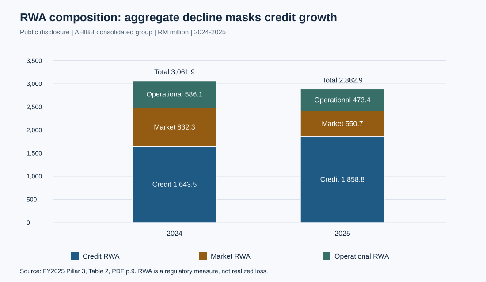

# 基于监管披露的资本充足性分析

[English](README.md)

Affin Hwang Investment Bank 的资本比率分解与反向压力测试（2024—2025）。

本研究讨论监管资本实力、风险结构变化与运营转型设计之间的关系，将经核实的 2024—2025 年公开披露与单独标识的风险排序、信用敏感性情景相结合。

**核心发现：**合并口径 CET1 比率的改善主要来自风险加权资产（RWA）分母下降。总 RWA 下降的同时，信用 RWA 仍在增加。因此，资本充足性改善所支持的结论有明确边界，不能据此推断所有风险均已下降。



## 研究发现

| 分析 | 结果 | 证据状态 |
|---|---|---|
| 合并口径 CET1 比率 | 2024 年 35.273%，2025 年 37.573% | 公开披露 |
| 对称比率分解 | 资本贡献 +0.108 个百分点，RWA 贡献 +2.193 个百分点 | 根据披露金额计算 |
| 合并口径风险结构 | 总 RWA −5.84%，信用 RWA +13.10% | 根据公开披露计算 |
| 单体口径比较 | CET1 改善 +0.872 个百分点，总 RWA −1.96% | 根据披露金额计算 |
| 以 20% 为分析参考的反向压力测试 | RWA 增长 50% 时，合并口径损失承受空间由 5.066 亿降至 2.183 亿马币 | 条件情景，不是预测 |
| 以 30% 为分析参考的损失—RWA 联合边界 | 假设损失 1 亿马币后，该参考下合并口径 RWA 扩张空间为 13.68% | 条件情景，不是银行限额 |
| 信用敏感性 | 总敞口口径预期损失 902.5 万马币，净敞口敏感性为 801.7 万马币 | 来源材料示例输入，不是银行实际拨备 |

本研究通过可复现计算，将证据口径、财务恒等式、敏感性分析与决策设计连接为可核验的分析链条。研究属于单一机构分析，不估计因果效应或银行特定事件的发生概率。

两种顺序归因路径均支持分母变化主导改善的解释。扩展资本边界进一步说明，损失吸收与 RWA 扩张消耗的是同一承受空间。公式、带符号缺口及假设见[研究报告](docs/zh-CN/report.md#41-损失与-rwa-的联合边界)。

## 阅读入口

- [研究报告与方法](docs/zh-CN/report.md)：业务模式、实体比较、资本分解及路径稳健性、反向压力及资本边界、风险等级敏感性和实施设计。
- [证据审查与重要更正](docs/zh-CN/evidence-audit.md)：来源、修正解释及尚未核实的主张。
- [参考资料与来源追踪](docs/zh-CN/references.md)：一手资料与可追踪输入记录。
- [数据字典](data/README.zh-CN.md)与[机器可读结果](results/summary.json)。

## 复现方法

使用 Python 3.10 或更高版本，**无需第三方运行依赖**，可直接根据仓库 CSV 离线运行。

```bash
python scripts/analyze.py
python -m unittest discover -s tests -v
```

第一条命令重新生成 `results/summary.json` 和四张 SVG 图和四份结果 CSV 表。若希望验证新运行且保留已提交结果：

```bash
python scripts/analyze.py --output local/reproduction
```

检查覆盖 RWA 加总、计算比率与披露比率的一致性、资本比率分解恒等式以及建议预算 2,650 万马币的加总。独立测试覆盖分解恒等式、反向压力边界和分类阈值。实际执行情况见[验证记录](docs/zh-CN/validation.md)。

## 证据与研究状态

公开披露观测、算术结果、示例假设和建议措施分别标注。风险矩阵和信用情景不代表已观测的银行内部数据；建议预算不是已批准支出，转型效益尚未实测。实施效益仍有待实际评估。

输入记录和原文件指纹见[来源追踪](docs/zh-CN/references.md#原始材料记录)。公开数据为研究所需的衍生表，原始 PDF 与行政附件保留在仓库之外。
