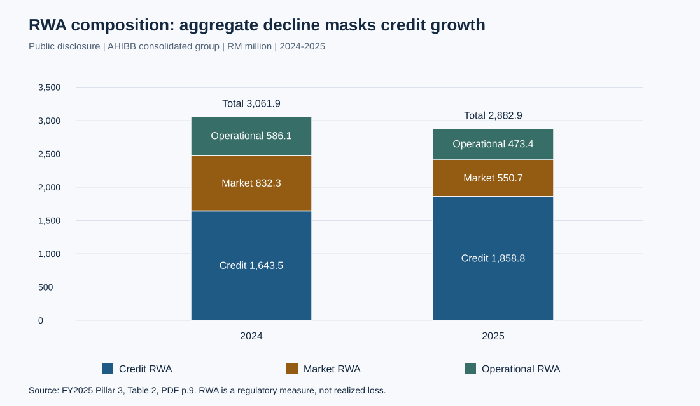
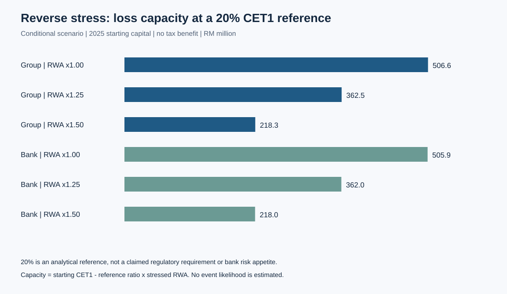
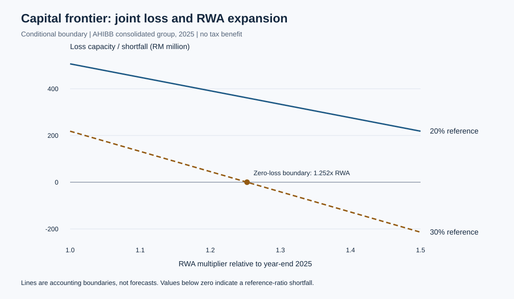
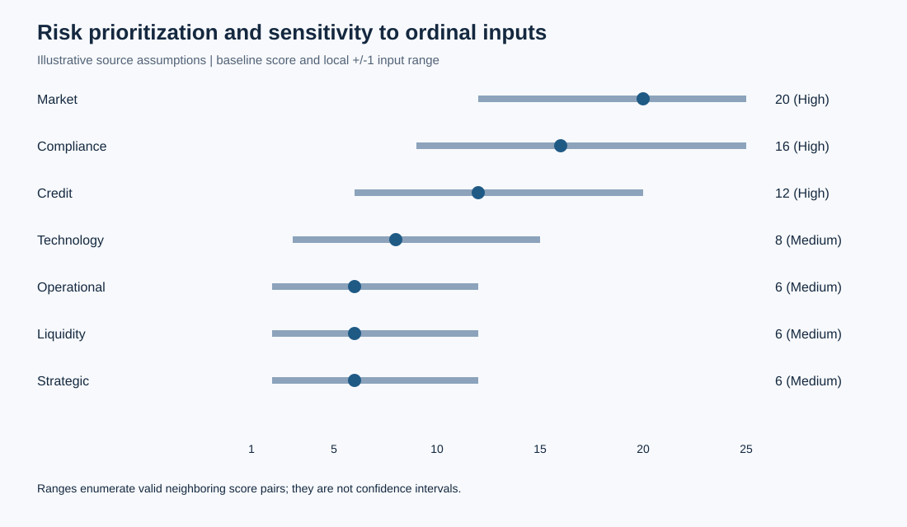

# Capital Resilience and Risk Transformation at Affin Hwang Investment Bank

[中文](../zh-CN/report.md) · [Project overview](../../README.md)

## Abstract

Capital ratios are informative about regulatory solvency but cannot by themselves establish that an investment bank has reduced every material source of risk. This study examines Affin Hwang Investment Bank Berhad (AHIBB) through an entity-consistent analysis of FY2024–FY2025 Pillar 3 disclosures. A symmetric decomposition attributes 2.193 percentage points of the consolidated CET1 ratio improvement to the RWA denominator and 0.108 points to the capital numerator. Credit RWA nevertheless increased by 13.10%. A reverse-stress extension shows how loss capacity depends jointly on the reference capital ratio and RWA expansion. Separately labeled risk and credit scenarios demonstrate sensitivity to assumptions and correct an exposure-definition error in the source analysis. The findings support a transformation strategy that integrates capital planning, exposure governance, reporting reliability, and operational resilience without treating unverified efficiency forecasts as established benefits.

## 1. Research problem and institutional context

Investment banking combines balance-sheet exposures with activities whose revenue depends on transactions, market participation, and client execution. AHIBB's disclosed principal activities include investment banking, stockbroking, options and futures dealing, and related financial services [1]. Its analytical value as a case is the coexistence of a high reported capital ratio and a changing regulatory risk mix. The question is: **what does the improvement in capital adequacy establish, and what additional evidence is needed to support a risk-transformation strategy?**

A coherent business model connects equity and debt issuance advisory, corporate transaction advice, securities execution, and market-risk intermediation. These functions can reinforce client relationships, but fee income remains exposed to market conditions, execution quality, and conduct controls. The source report's detailed product descriptions are useful hypotheses for institutional analysis; its precise market shares and divisional revenue weights lack an independently verified denominator and are not used as empirical inputs here.

The conceptual distinction is between regulatory capital adequacy, economic risk, and operating effectiveness. RWA reflect regulatory measurement and portfolio composition. A lower denominator can raise a ratio even if capital changes little. It does not establish lower event frequency, better credit underwriting, stronger technology controls, or improved profitability.

## 2. Evidence design and entity boundaries

The verified quantitative sample contains four entity-year observations: the AHIBB consolidated group and the AHIBB standalone bank, each in 2024 and 2025. The AHIBB group is not the broader AFFIN banking group. The disclosure explicitly distinguishes these columns [1, Table 2, PDF p.9]. This distinction is decisive because an entity comparison can otherwise be mistaken for a time-series change.

The following hierarchy governs the study:

1. **Public observations:** manually transcribed capital and RWA data checked against the official disclosure and the financial-report images embedded in the supplied report.
2. **Computed results:** reconciliations, ratio decomposition, changes in risk composition, and conditional loss capacities.
3. **Illustrative inputs:** source-report risk score pairs and credit parameters, retained for sensitivity analysis with their unvalidated status visible.
4. **Proposals:** budget allocations and implementation actions, whose benefits and execution are not observed.

The research is a descriptive financial analysis with deterministic sensitivity extensions. There is no panel, counterfactual treatment, return series, internal event log, or loan-level dataset. Statistical significance and causal identification are therefore outside the design. The [evidence audit](evidence-audit.md) records exclusions rather than silently converting uncertain numbers into facts.

## 3. Capital ratio decomposition

Let $C_t$ be CET1 capital and $R_t$ total RWA at year-end $t$, in the same monetary units. The ratio in percent is $q_t=100C_t/R_t$. A two-factor symmetric decomposition averages the two possible orders in which capital and RWA change:

$$
\Delta q_C=50(C_1-C_0)(R_0^{-1}+R_1^{-1}),
$$

$$
\Delta q_R=50(C_0+C_1)(R_1^{-1}-R_0^{-1}).
$$

These contributions, measured in percentage points, sum exactly to $q_1-q_0$. This is an accounting attribution with a symmetric allocation of the interaction; it is not a causal estimate. The computations use disclosed monetary amounts rather than rounded printed ratios.

| Entity | Reported CET1 2024 | Reported CET1 2025 | Capital contribution, pp | RWA contribution, pp | Total change, pp |
|---|---:|---:|---:|---:|---:|
| AHIBB consolidated group | 35.273% | 37.573% | 0.108 | 2.193 | 2.300 |
| AHIBB standalone bank | 36.701% | 37.573% | 0.138 | 0.734 | 0.872 |

Source inputs: [1, Table 2]; contributions computed in this project. Small differences between displayed totals and rounded contributions are rounding effects.

The consolidated interpretation is dominated by denominator contraction. The standalone improvement is smaller because its 2024 starting ratio was already higher. Substituting the consolidated 2024 ratio for the standalone ratio materially exaggerates the standalone improvement.

### 3.1 Robustness to the order of attribution

Symmetric attribution is a convention for distributing the interaction between changing capital and changing RWA. Its interpretation can be checked against both sequential paths. Changing capital first assigns $100(C_1-C_0)/R_0$ to capital and $100C_1(1/R_1-1/R_0)$ to RWA. Changing RWA first uses $R_1$ in the capital term and $C_0$ in the RWA term. Each path exhausts the same total ratio change; their component-wise mean is the symmetric decomposition.

| Entity | Capital contribution across paths, pp | RWA contribution across paths, pp |
|---|---:|---:|
| AHIBB consolidated group | 0.1045–0.1110 | 2.1895–2.1959 |
| AHIBB standalone bank | 0.1366–0.1393 | 0.7322–0.7350 |

These are attribution-choice ranges, not confidence intervals. RWA contraction remains the dominant arithmetic contributor under either path. The central interpretation therefore does not depend on selecting the symmetric interaction allocation. Exact path outputs are supplied in [decomposition-paths.csv](../../results/decomposition-paths.csv).

### 3.2 Risk composition and the limits of aggregate de-risking

| Entity and component | 2024, RM million | 2025, RM million | Change, RM million |
|---|---:|---:|---:|
| Group: credit RWA | 1,643.511 | 1,858.823 | +215.312 |
| Group: market RWA | 832.279 | 550.666 | −281.613 |
| Group: operational RWA | 586.099 | 473.450 | −112.649 |
| Group: total RWA | 3,061.889 | 2,882.939 | −178.950 |
| Bank: credit RWA | 1,640.688 | 1,856.994 | +216.306 |
| Bank: market RWA | 832.279 | 550.666 | −281.613 |
| Bank: operational RWA | 463.531 | 471.398 | +7.867 |
| Bank: total RWA | 2,936.498 | 2,879.058 | −57.440 |

Inputs from [1, Table 2]; changes computed. Figure 1 visualizes the consolidated pattern.

The consolidated total declines by 5.84%, while credit RWA rises by 13.10%. At standalone level, total RWA falls by 1.96%, credit RWA rises by 13.18%, and operational RWA increases. The defensible inference is a shift in regulatory risk composition. These data do not identify whether changes arise from position size, counterparty composition, collateral, methodology, or another driver; additional portfolio disclosures would be needed to distinguish them.

## 4. Reverse stress and conditional capital capacity

For an analytical reference ratio $k$, expressed as a fraction, an RWA multiplier $m$, and an immediate CET1 loss $L$, impose:

$$
\frac{C-L}{mR}=k \quad\Longrightarrow\quad L^*=C-kmR.
$$

The model assumes loss reduces CET1 one-for-one, without tax relief, earnings replenishment, dividends, management actions, or additional regulatory adjustments. RWA are exogenously fixed within each scenario. This is a partial-equilibrium accounting boundary; a real stress could jointly change capital, RWA, liquidity, and franchise value. A negative value is an initial shortfall relative to the chosen reference, not a negative economic loss.

The grid evaluates 7%, 20%, and 30% references against RWA multipliers of 1.00, 1.25, and 1.50 for both entities. The 7% reference is the CET1 requirement described in the FY2025 disclosure [1, section 2.2]; it is not a claim about every applicable present-day institution-specific requirement. The 20% and 30% references are research assumptions, not regulatory minima or disclosed internal targets.

At the 20% reference, consolidated capacity is RM506.6m with unchanged RWA, RM362.5m at 25% expansion, and RM218.3m at 50% expansion. The corresponding standalone amounts are RM505.9m, RM362.0m, and RM218.0m. At a 30% reference and 50% expansion, the consolidated result is a RM214.1m shortfall. These scenarios demonstrate that apparent capital headroom is conditional on the denominator and selected reference; they do not estimate the likelihood of such stresses or imply distributable capital.

### 4.1 The joint loss–RWA frontier

Rearranging the same inequality gives the maximum RWA multiplier consistent with a selected reference after an assumed immediate loss:

$$
m_{\max}(L,k)=\frac{C-L}{kR}.
$$

For positive $k$ and $R$, feasible positive multipliers satisfy $0<m\le m_{\max}$. If $m_{\max}\le0$, no positive RWA level satisfies the reference under the assumed loss. The slope $\partial m_{\max}/\partial L=-1/(kR)$ measures the trade-off between loss absorption and denominator expansion in this accounting scenario. It does not identify how actual RWA would respond to a loss.

At the 30% analytical reference, the consolidated zero-loss boundary is 1.2524 times starting RWA, equivalent to 25.24% expansion. After an assumed RM100m loss it is 1.1368 times, or 13.68% expansion; after RM200m, only 2.12% expansion remains. At exactly 25% expansion, only RM2.113m of additional loss fits that reference. Thus seemingly separate loss and growth tolerances cannot be added as independent buffers. The 30% reference is hypothetical throughout.

The figure retains signed values: below-zero capacity is a reference-ratio shortfall, not zero loss capacity. It shows the consolidated group because the 2025 standalone frontier is nearly coincident; both entities are retained in [capital-frontier.csv](../../results/capital-frontier.csv). The 18 loss-capacity scenarios are available in [reverse-stress.csv](../../results/reverse-stress.csv). Lines evaluate the stated accounting identity; they do not interpolate unobserved historical data or constitute forecast paths.

## 5. Risk prioritization under uncertain ordinal inputs

The source framework multiplies impact $I$ and likelihood grade $P$, each from 1 to 5. Its thresholds are retained as project conventions: Low 1–4, Medium 5–9, High 10–25. These exact cutoffs are not attributed to ISO 31000 or COSO. The official ISO overview describes a principles-and-process framework [3]; it does not substantiate the source's claim that these numerical cutoffs are mandated.

Multiplication of ordinal labels is a prioritization heuristic. A score of 20 is not a monetary expected loss, twice a score of 10 need not mean twice the risk, and a frequency count is not interchangeable with a probability without an exposure horizon and statistical model. No undocumented distribution has been fitted to internal incidents.

For each supplied pair, the analysis enumerates every valid pair within one grade of both inputs. Market risk remains High over its local score range of 12–25. Compliance spans 9–25, and credit spans 6–20, crossing the High/Medium boundary. Technology and several other categories cross all three classes. These are deterministic perturbation ranges, not sampling confidence intervals.

The implication is procedural: the committee should inspect underlying evidence and control failures when a category changes under modest input perturbations. The ranking should not be used to allocate capital mechanically. Reputational risk is discussed qualitatively because Appendix B does not supply an explicit reconstructible input pair for it.

## 6. Credit exposure correction and parameter sensitivity

The source table labels RM11.8m, RM4.3m, RM5.3m, and RM0.6m as exposure at default (EAD). Those values approximately match gross exposure multiplied by PD, rather than exposure itself. They neither establish EAD nor include LGD. The public dataset preserves that column under `original_ead_label_rm_million` to make the correction inspectable.

A simplified one-period expected-loss calculation is:

$$
EL=\sum_j EAD_j\,PD_j\,LGD_j.
$$

Using gross exposures as an explicit EAD assumption produces RM9.025m; using net exposures instead produces RM8.017m. The latter is a sensitivity, not a validated collateral treatment. PD and LGD remain source assumptions. This is not a complete MFRS 9 ECL implementation: it omits staging, lifetime term structures, scenario weights, discounting, forward-looking calibration, recoveries, and off-balance-sheet conversion.

The extended grid scales PD by 0.5, 1.0, 1.5, and 2.0 and shifts LGD by −10, 0, and +10 percentage points, bounding both to [0,1]. Gross-basis results span RM3.416m–RM22.438m; all 12 combinations are exported in [credit-sensitivity.csv](../../results/credit-sensitivity.csv). This range reveals parameter dependence, not an empirical uncertainty interval. It cannot be combined with the verified capital analysis as if it were a measured loss forecast for AHIBB.

## 7. Transformation design and implementation discipline

The source proposes RM26.5m across six workstreams: market RM3.5m; compliance RM5.5m; credit RM4.2m; technology RM8.5m; operational RM2.8m; liquidity RM2.0m. Technology accounts for 32.08%. These allocations are retained as a design input, not described as optimized, scientifically calibrated, approved, or spent. Software licensing and hires cannot all be assumed to qualify as accounting capital expenditure.

The source's strategic themes—digital workflow improvement, reporting automation, credit controls, transition-finance origination, and cross-border advisory—become testable work packages:

| Work package | Required evidence before approval | Evaluation and release gate |
|---|---|---|
| Reporting lineage and validation | Submission inventory, entity ownership, versioned rule mappings, reconciled error baseline | Parallel-run accuracy and exception resolution; accountable compliance sign-off |
| Technology resilience | Incident taxonomy, critical-service mapping, recovery objectives, third-party dependencies | Tested restoration and failover, measured recovery time and data loss, recorded residual risks |
| Analyst assistance | Representative task sample, access boundaries, human-review policy | Compare turnaround time, material errors, and review effort against a documented baseline |
| Credit and market controls | Portfolio concentrations, PD/LGD validation, limit governance, breach history | Independent challenge, escalation tests, and monitoring of overrides and unintended consequences |
| Transition finance and advisory | Client mandate evidence, project economics, eligibility and disclosure criteria | Transaction-level diligence and realized fee contribution after execution costs |

The verified BNM action announced on 6 May 2024 concerns RM120,000 imposed on Affin Bank Berhad for reporting-related non-compliance [2]. It motivates careful legal-entity attribution and reliable reporting controls. It does not establish a 2025 AHIBB AML penalty table or substantiate source-report internal breach counts.

Implementation should use relative phases because the source's calendar descriptions conflict. An initial phase establishes ownership and baselines; a pilot phase evaluates controls and benefits; subsequent rollout depends on independent review and recorded acceptance of residual risk. No claim is made that any phase has occurred. Specific time savings, revenue uplifts, market shares, and automated elimination of trading losses remain untested hypotheses.

## 8. Limitations and conclusion

Two year-end observations per entity support accounting analysis, not a structural model of profitability or tail dependence. Disclosed amounts are rounded. The illustrative risk and credit inputs have no reproducible internal sampling or calibration record. The reverse-stress model omits behavioral and balance-sheet feedback. The project does not verify the source's CIR, HQLA, league-table shares, internal cyber incidents, or forecast transformation returns.

Within these boundaries, the study establishes a substantive result: stronger capital ratios coexist with increasing credit RWA, and entity selection changes the magnitude of apparent improvement. A mature transformation program should therefore connect capital headroom with portfolio composition, reliable reporting, measurable service resilience, and independently tested operating benefits. A high capital ratio is a starting condition for that program, not evidence that its work has already been completed.

Numbered references and source provenance are listed in [references](references.md). All numerical outputs are generated by [the analysis script](../../scripts/analyze.py) from the documented CSV inputs.
