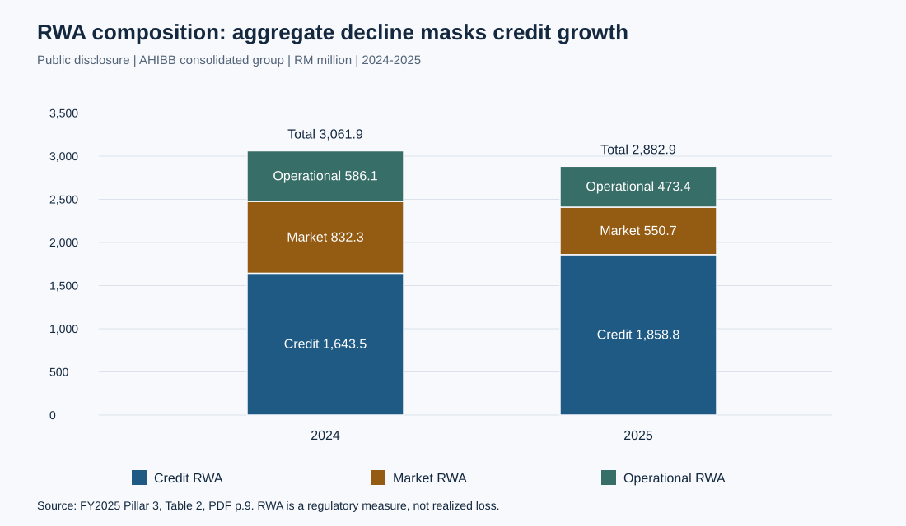
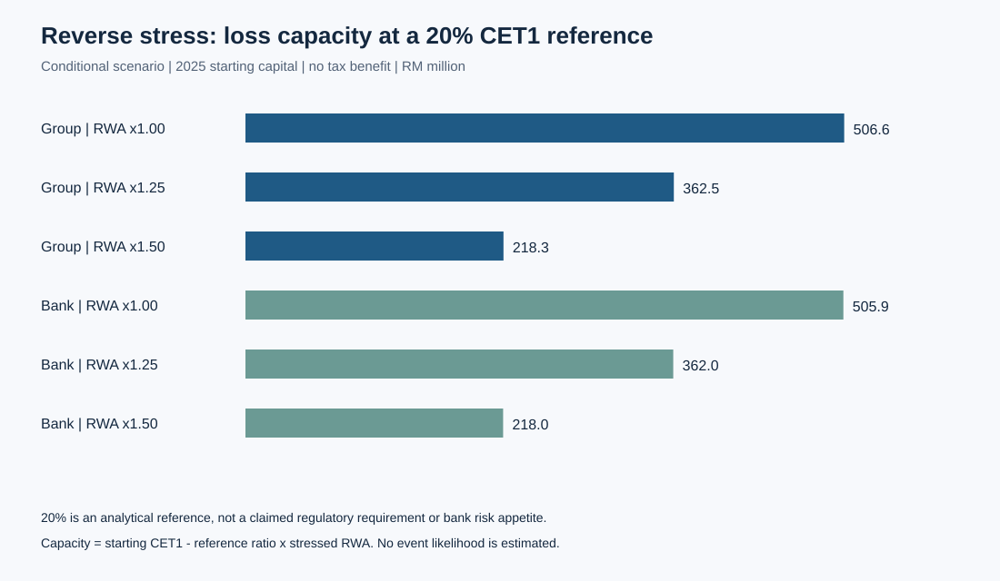
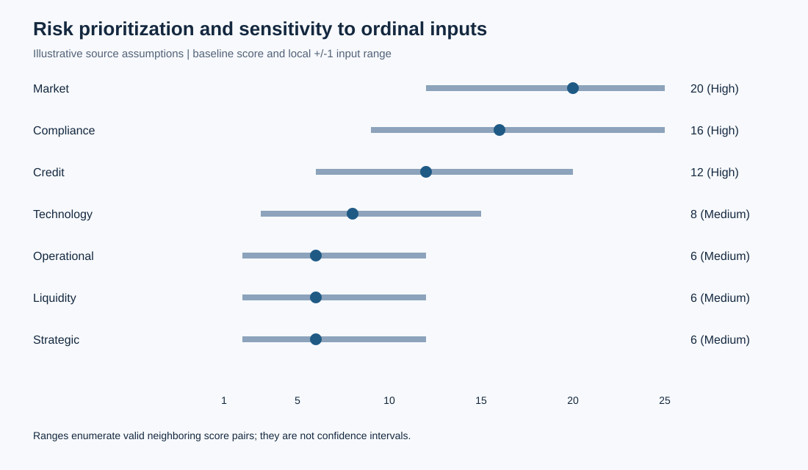

# Affin Hwang Investment Bank ���ʱ����������ת��

[English](../en/report.md) �� [��Ŀ���](../../README.zh-CN.md)

## ժҪ

�ʱ������ܹ���ӳ��ܳ�����������������֤��Ͷ�еĸ����ش���վ����½������о��� Affin Hwang Investment Bank Berhad��AHIBB��Ϊ���󣬰�һ�µ�ʵ��ھ����� 2024��2025 �����֧����¶���ԳƷֽ���ʾ���ϲ��ھ� CET1 ���ʸ����У�RWA ��ĸ����Լ 2.193 ���ٷֵ㣬�ʱ����ӹ���Լ 0.108 ���ٷֵ㣻ͬ������ RWA ȴ���� 13.10%���о���һ��ͨ������ѹ�����Խ�ʾ�ʱ����ܿռ�Բο����ʼ� RWA ���ŵ����������Ե�����ʶ�ķ��ա������龰������������ԣ�����ԭ�����еij��ڶ�����󡣽��֧�ֽ��ʱ��滮���������������Ϳɿ��Ժ���Ӫ���Խ��������ת�ͷ������Ҳ���δ����֤��Ч��Ԥ����Ϊ����Ч�档

## 1. ��������������

Ͷ�����мȳе��ʲ���ծ�����գ�Ҳ�������׻���г����뼰�ͻ�ִ�в������롣AHIBB ������¶����Ҫҵ�����Ͷ�����С�֤ȯ���͡���Ȩ���ڻ����׼���ؽ��ڷ���[1]��������ֵ���о�֮�������ڽϸߵ��ʱ��������ܷ��սṹ�仯ͬʱ���ڡ����������ǣ�**�ʱ������Ը��ƾ���˵����ʲô������ת�ͷ�������Ҫ��Щ����֤�ݣ�**

��Ȩ��ծ�����ʹ��ʡ���ҵ������ѯ��֤ȯִ�к��г������н鹲ͬ���������ҵ���߼�����Щҵ�����ǿ���ͻ���ϵ�������������������г�������ִ����������Ϊ����Ӱ�졣ԭ�����еIJ�Ʒ���ۿ������γɻ���������˵���侫ȷ�г��ݶ�ֲ�����ռ��ȱ����������ʵ��ͳ�Ʒ�ĸ����˲�����ʵ֤���롣

�о����ּ���ʱ������ԡ����÷��պ���ӪЧ����RWA ��ӳ��ܼ�������Ͻṹ����ĸ�½��������ʱ��仯��Сʱ̧�����ʣ�������֤���¼�Ƶ���½��������������ơ�����������ǿ��ӯ������������

## 2. ֤�������ʵ��߽�

����ʵ�Ķ���������������ʵ����ȼ�¼��AHIBB �ϲ����ż� AHIBB ���е�����Ե� 2024��2025 �����ݡ�AHIBB �ϲ����Ų�ͬ�ڸ��㷺�� AFFIN ���м��š�������¶��ȷ������Щ��[1���� 2��PDF �� 9 ҳ]����һ����������Ҫ������ʵ�������ܱ����Ϊ��ȱ仯��

���о���������֤�ݲ�Σ�

1. **�����۲⣺**�ֶ�ת¼�ʱ��� RWA������ٷ���¶���û�������Ƕ�IJƱ�ͼ�񽻲�˲顣
2. **��������**���ܺ˶ԡ����ʷֽ⡢���սṹ�仯��������ʧ���ܿռ䡣
3. **ʾ�����룺**����ԭ����ķ������ּ����ò������������Է�����ͬʱ��ȷ��δ����֤��״̬��
4. **�����ʩ��**Ԥ���ʵʩ�ж����������ʵ��ִ�о�δ���۲⡣

�о����������Բ��������ȷ������������չ��û���������������ʵ���������������С��ڲ��¼���־�������ϸ����˲���չͳ�������Լ�������ʶ��[֤�����](evidence-audit.md)��ȷ��¼�ų�����⽫��ȷ������Ĭ��Ϊ��ʵ��

## 3. �ʱ����ʱ䶯�ֽ�

�� \(C_t\) Ϊ��ĩ CET1 �ʱ���\(R_t\) Ϊͬһ��λ�µ��� RWA���԰ٷ�����ʾ�ı���Ϊ \(q_t=100C_t/R_t\)���Գ������ӷֽ�ԡ��ȸı��ʱ����͡��ȸı� RWA������·��ȡƽ����

\[
\Delta q_C=50(C_1-C_0)(R_0^{-1}+R_1^{-1}),
\]

\[
\Delta q_R=50(C_0+C_1)(R_1^{-1}-R_0^{-1}).
\]

������԰ٷֵ�������ϸ����Ϊ \(q_1-q_0\)���÷����Խ��������Գ����ã����ڻ�ƹ������������ơ�����ʹ����¶����ֱ��ʹ����ȡ���ı��ʡ�

| ʵ�� | 2024 ����¶ CET1 | 2025 ����¶ CET1 | �ʱ����ף��ٷֵ� | RWA ���ף��ٷֵ� | �ܱ仯���ٷֵ� |
|---|---:|---:|---:|---:|---:|
| AHIBB �ϲ����� | 35.273% | 37.573% | 0.108 | 2.193 | 2.300 |
| AHIBB ����� | 36.701% | 37.573% | 0.138 | 0.734 | 0.872 |

��������[1���� 2]������ֵ�ɱ���Ŀ���㡣��ʾ��ֵ���ܿ��ܴ���ȡ�����졣

�ϲ��ھ�������Ҫ���Է�ĸ������������ƽ�С������Ϊ�� 2024 ���ʼ�����ѽϸߡ����ϲ��ھ� 2024 ��������ڵ���Ƚϣ������Կ������Ƴ̶ȡ�

### 3.1 ���սṹ������ȥ���ջ��Ľ��ͱ߽�

| ʵ�弰������ | 2024 �꣬�������� | 2025 �꣬�������� | �仯���������� |
|---|---:|---:|---:|
| �ϲ������� RWA | 1,643.511 | 1,858.823 | +215.312 |
| �ϲ����г� RWA | 832.279 | 550.666 | ?281.613 |
| �ϲ������� RWA | 586.099 | 473.450 | ?112.649 |
| �ϲ����� RWA | 3,061.889 | 2,882.939 | ?178.950 |
| ���壺���� RWA | 1,640.688 | 1,856.994 | +216.306 |
| ���壺�г� RWA | 832.279 | 550.666 | ?281.613 |
| ���壺���� RWA | 463.531 | 471.398 | +7.867 |
| ���壺�� RWA | 2,936.498 | 2,879.058 | ?57.440 |

��������[1���� 2]���仯�ɱ���Ŀ���㡣ͼ 1 չʾ�ϲ��ھ��ṹ��

�ϲ��� RWA �½� 5.84%������ RWA ���� 13.10%�������� RWA �½� 1.96%������ RWA ���� 13.18%������ RWA Ҳ�������ӡ�֤��֧�ּ�ܷ��սṹ�����仯�����������޷����ֱ仯��������ͷ���ģ�����׶��ֽṹ����ѺƷ�����������������������أ���Ҫ���������¶����ʶ��

## 4. ����ѹ���������ʱ����ܿռ�

������ο�����ΪС�� \(k\)��RWA ����Ϊ \(m\)����ʱ CET1 ��ʧΪ \(L\)�����У�

\[
\frac{C-L}{mR}=k \quad\Longrightarrow\quad L^*=C-kmR.
\]

ģ�ͼ�����ʧһ��һ���� CET1��������˰�յּ������󲹳䡢��Ϣ�������ж���������ܵ�����ÿ���龰�� RWA �������������Ǿֲ������Ʊ߽磬��ʵѹ�����ܹ�ͬ�ı��ʱ���RWA�������Ժ�������Ӫ��ֵ����ֵ��ʾ�������ѡ�ο�ֵ�Ѵ��ڳ�ʼȱ�ڣ�����ʾ��������ʧ��

���������ʵ��ֱ���� 7%��20%��30% �ο������� 1.00��1.25��1.50 �� RWA ����ϡ�7% ���� 2025 �����֧����¶���� CET1 Ҫ��[1���� 2.2 ��]������ʾ�����е�ǰ�����ض�Ҫ����жϣ�20% �� 30% ���о����裬���Ǽ�����Ҫ�������¶�������ڲ�Ŀ�ꡣ

�� 20% Ϊ�ο����ϲ��ھ��� RWA ���䡢���� 25% ������ 50% ʱ�ij��ܿռ�ֱ�Ϊ 506.6��362.5 �� 218.3 �������ң�����ֱ�Ϊ 505.9��362.0 �� 218.0 �������ҡ��� 30% Ϊ�ο��� RWA ���� 50% ʱ���ϲ��ھ����� 214.1 ��������ȱ�ڡ���Щ�龰˵���ʱ�����ȡ���ڷ�ĸ���ο���׼�����ܽ���Ϊ�龰�������ʻ�ɷ����ʱ���

## 5. �������벻ȷ�����µķ�������

ԭ��ܽ� 1 �� 5 ����Ӱ�� \(I\) ������Եȼ� \(P\) ��ˡ����о�������ͷ��� 1��4���з��� 5��9���߷��� 10��25 �ķ��࣬��Ϊ��ĿԼ����������Щ��ȷ��ֵ������ ISO 31000 �� COSO��ISO �ٷ���������ԭ�������̿��[3]��������֧��ԭ�����С�������ֵ��ֵ�ɱ�׼�涨����˵����

�����ǩ�����һ����������ʽ��20 �ֲ��ǻ���Ԥ����ʧ��20 ��Ҳ����Ȼ��ζ�� 10 �ֵ��������ա�ȱ����ȷ��¶�ڼ��ͳ��ģ��ʱ��Ƶ�β���ֱ�ӵ������ʡ�����Ŀû��Ϊ�ڲ��¼����ȱ����¼�ķֲ���

�����Է���ö��ÿ���������������Ӹ��仯һ��ʱ��ȫ����Ч��ϡ��г����շ�ֵΪ 12��25��ʼ�ձ��ָ߷��գ��Ϲ����Ϊ 9��25�����÷���Ϊ 6��20������Խ�ߡ��з��ձ߽磻�������������ɷ��տ�Խ�����ȼ�����Щ��ȷ�����Ŷ����䣬���dz����������䡣

����С�������Ŷ����·���ı�ʱ��ίԱ��Ӧ���ײ�֤�������ȱ�ڣ����ܻ�е�ذ���ֵ�����ʱ�����¼ B δ�����������տ���ȷ��ԭ����������ϣ���˽����������ۡ�

## 6. ���ó��ڶ�����������������

ԭ���� 11.8��4.3��5.3��0.6 �������ұ��ΪΥԼ���ճ��� EAD����Щ��ֵ���Ƶ����ܳ��ڳ� PD�����dz��ڱ�����Ҳû�а��� LGD������������ `original_ead_label_rm_million` ����ԭ�У����ں˶Ը�����

�򻯵���Ԥ����ʧ��ʽΪ��

\[
EL=\sum_j EAD_j\,PD_j\,LGD_j.
\]

��ȷ�����ܳ���Ϊ EAD ʱ�õ� 9.025 �������ң�ʹ�þ�������Ϊ 8.017 �������ҡ����߽�Ϊ�����Լ��㣬����������֤�ĵ�ѺƷ����������PD �� LGD ��Ϊԭ���ϼ��衣�ü��㲻�������� MFRS 9 ECL ʵ�֣�δ�������ڡ����������ߡ��龰Ȩ�ء����֡�ǰհУ׼�����ռ���������ת����

��չ���� PD ����Ϊ 0.5��1.0��1.5��2.0 ������ LGD ���� ?10��0��+10 ���ٷֵ㣬�������������� [0,1]���ܳ��ڿھ������ΧΪ 3.416��22.438 �������ң���ʾ���������ԣ����Ǿ��鲻ȷ�����䡣��Щ����������Ѻ�ʵ�ʱ����ݺϲ�������Ϊ AHIBB ��ʵ����ʧԤ�⡣

## 7. ת�ͷ�����ʵʩԼ��

ԭ���潨��Ԥ�� 26.5 �������ң�����Ϊ�г� 3.5���Ϲ� 5.5������ 4.2������ 8.5������ 2.8�������� 2.0 �������ң�����ռ 32.08%�����о����䱣��Ϊ�������룬���������Ż����ѿ�ѧУ׼������׼����֧�����������ĺ���Ƹ����ȫ��Ĭ�Ϸ��ϻ���ʱ���������

ԭ�о��������ֹ������������Զ��������ÿ��ơ�ת�����ʺͿ羳���ʵ����⣬Ӧת��Ϊ�ɼ���Ĺ�������

| ������ | ��׼ǰ��Ҫ��֤�� | �������������� |
|---|---|---|
| ����ѪԵ����֤ | �����嵥��ʵ�����Ρ�����汾ӳ�䡢������ߺ˶� | ��������׼ȷ�ԡ��쳣�ջ����Ϲ渺����ǩ�� |
| �������� | �¼����ࡢ�ؼ�����ͼ�ס��ָ�Ŀ�ꡢ���������� | �ָ��͹����л����ԡ�ʵ��ָ�ʱ����������ʧ��������ռ�¼ |
| ����ʦ���� | �������������������ʱ߽硢�˹����˹��� | ����߱Ƚϴ���ʱ�䡢�ش���󼰸��˹����� |
| ���ü��г����� | ���жȡ�PD/LGD ��֤���޶�������������ʷ | ������ѯ�������������ԡ��˹����Ǽ���Ԥ�ں����� |
| ת�����ʼ����� | �ͻ�ί�С���Ŀ�����ԡ�׼�뼰��¶��׼ | ���׾������Լ��۳�ִ�гɱ����ʵ�������ѹ��� |

����ʵ�� BNM ������ 2024 �� 5 �� 6 �շ��������� Affin Bank Berhad ������ز��Ϲ汻�� 120,000 ����[2]����һ��ʵ֧�ּ�ǿʵ������뱨�Ϳ��ƣ�������֤��ԭ�������е� AHIBB 2025 �� AML ��������ڲ�Υ�������

����ԭ���治ͬλ�õ��������ų�ͻ��ʵʩ���������Խ׶Σ�����ȷ���κͻ��ߣ��ٿ�չ������Ч���Ե㣬������ݶ�����鼰������ս��ܼ�¼�����ƹ㡣����Ŀ�������κν׶��Ѿ���ɡ����幤ʱ��ʡ�������������г��ݶ�Զ�����������ʧ��˵��������δ�����˵��

## 8. ���������

ÿ��ʵ��ֻ��������ĩ�۲⣬��֧�ֻ�Ʒ��������ܹ���ӯ����β�������Ľṹģ�͡���¶����ȡ����ʾ�����ռ���������ȱ���ɸ��ֵ��ڲ�������У׼��¼������ѹ��ģ��û����Ϊ���ʲ���ծ������������Ŀ����ʵԭ�����еijɱ�����ȡ�HQLA�����а�ݶ�ڲ������¼���ת������Ԥ�⡣

����Щ�߽��ڣ��о��γ���ȷ���ۣ��ʱ����ʸ��������� RWA �������Բ��棬ʵ��ھ���ı������Ʒ��ȡ������ת�ͼƻ�Ӧ���ʱ��ռ�����Ͻṹ���ɿ����͡��ɲ����������Ժ;��������������ӪЧ�������ӡ��ϸ��ʱ�����Ϊת���ṩ��ʼ����������֤��ת�͹����Ѿ���ɡ�

���������ԭ������Ϣ��[�ο�����](references.md)��ȫ����ֵ�����[�����ű�](../../scripts/analyze.py)������˵���� CSV �������ɡ�
